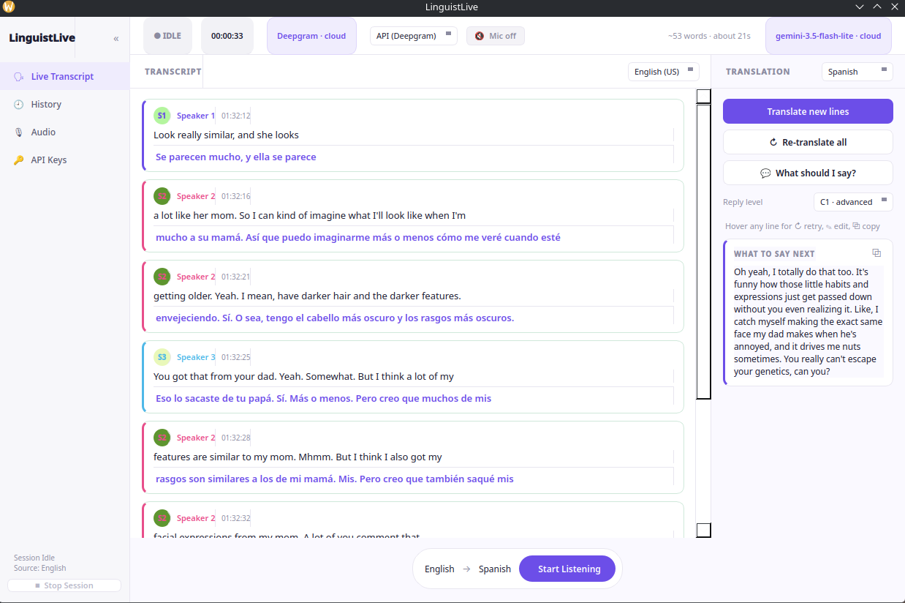
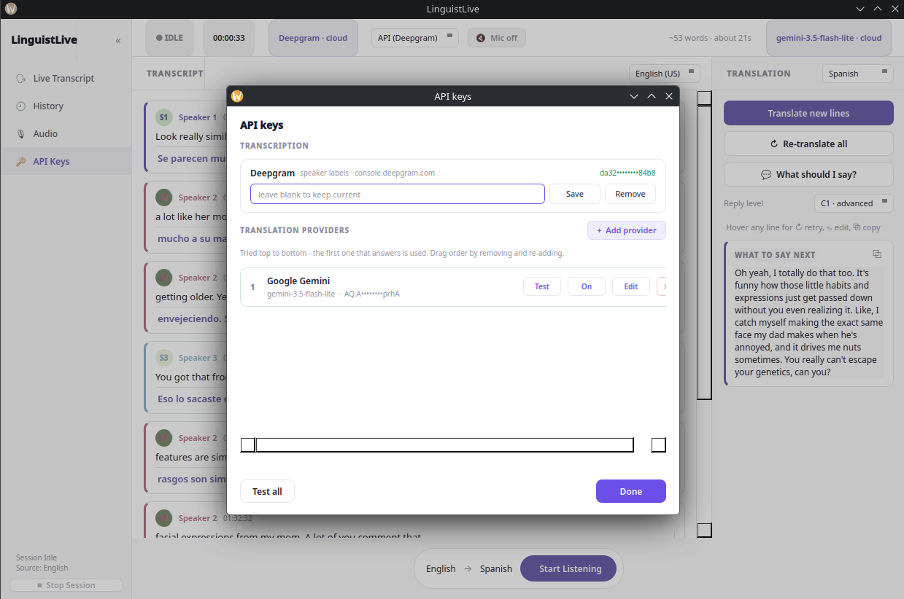

# MeetingScribe

**Live transcription and translation for online meetings.**

MeetingScribe listens to whatever your computer is playing — Zoom, Teams,
Google Meet, anything — and turns it into text as people speak. Then it
translates that text into the language you choose, labels who said what, and
can even draft what you might say next.

Runs on **Linux and Windows**. Works with cloud AI, or fully offline on your
own GPU.


---

## Screenshots

### Live transcript and translation
<!-- Replace with your screenshot. Recommended: full window, mid-session,
     a few translated lines visible. Save it as docs/screenshot-main.png -->


*Each line is a card: the original on top, the translation underneath.
Colours show who is speaking and which lines are done.*

### Managing providers and models
<!-- Replace with your screenshot. Recommended: the API Keys panel with a
     provider or two listed. Save it as docs/screenshot-settings.png -->


*Add any number of translation providers, test them, and reorder them as
fallbacks. Whisper models download from inside the app.*

---

## What it does

| | |
|---|---|
| **Hears everything** | Any app that makes sound — no plugins, no bots joining your call |
| **Live transcript** | Text appears while people are still talking |
| **Who said what** | Colour-coded speaker labels (cloud mode) |
| **Translation** | 10 languages, one click, batched to stay cheap |
| **Your own voice too** | Mixes in your microphone, with automatic ducking |
| **"What should I say?"** | Drafts a natural reply from the last few minutes |
| **Works offline** | Whisper on your GPU — no audio leaves the machine |
| **Saved meetings** | Autosaves; browse, reopen and export later |

---

## Quick start

```bash
git clone https://github.com/<you>/meetingscribe.git
cd meetingscribe

python3 -m venv .venv
source .venv/bin/activate          # Windows: .venv\Scripts\activate
pip install -r requirements.txt

python3 hybrid_translator.py
```

On first launch, open **🔑 API Keys** in the sidebar and paste in a key.
That's the whole setup — no config files to edit.

**Linux** needs `parec`, which ships with PulseAudio/PipeWire (already present
on most distros). **Windows** needs nothing extra; `pip install -r
requirements.txt` handles it.

---

## Getting API keys

Both have free tiers that comfortably cover everyday use.

| What for | Where | Needed? |
|---|---|---|
| **Transcription** | [console.deepgram.com](https://console.deepgram.com) | Only for cloud mode |
| **Translation** | [aistudio.google.com/apikey](https://aistudio.google.com/apikey) | Yes, for translation |

Translation also works with **Groq**, **OpenAI**, **xAI**, **OpenRouter**, or
any OpenAI-compatible endpoint. Add as many as you like — MeetingScribe tries
them in order, so a second one acts as a fallback when the first is busy.

Offline transcription needs no key at all.

---

## Using it

1. **Pick an engine** in the top bar — *API (Deepgram)* or *Local (Whisper)*
2. **Choose languages** — spoken on the left, translated on the right
3. **Press Start Listening** and play your meeting
4. **Press Translate** whenever you want the translation

### Every line is editable

Hover any transcript card:

| | |
|---|---|
| **↻** | translate this line again |
| **✎** | fix a misheard word, then re-translate |
| **⧉** | copy |

Nothing is one-way. Changed your mind about the target language? **Re-translate
all** redoes the whole meeting.

### Your microphone

Meeting audio alone gives you everyone *except you*. Turn on the mic with the
**🎙 Mic** button in the top bar, or **Ctrl+M** — instantly, mid-meeting, no
restart.

When you speak, the meeting audio automatically **ducks** (drops to a quarter)
so your voice isn't buried under it. Both the mic level and the duck amount
are adjustable under **🎙 Audio**.

### What should I say?

Reads the last 15 lines and drafts something natural you could say next, at
whatever CEFR level you pick (**A2** to **C1**). Useful when you're following
a meeting in a second language and need a moment to think.

---

## Offline mode

Choose **Local (Whisper)**, then **⚙ Models** to download one:

| Model | Size | Good for |
|---|---|---|
| `tiny` / `base` | 75–145 MB | quick tests |
| `small` | 480 MB | modest hardware |
| `large-v3-turbo` | 1.6 GB | **best balance** |
| `large-v3` | 3.1 GB | maximum accuracy |

Downloads show live progress and can be removed from the same window.

Offline mode never sends audio anywhere — but it can't tell speakers apart,
since that needs the cloud model.

---

## Better accuracy

Edit **`keyterms.py`** and add words your meetings actually use:

```python
PEOPLE    = ["Ayse Yilmaz", "Mehmet Demir"]
COMPANIES = ["Acme Corp"]
PRODUCTS  = ["Jira", "Confluence"]
```

These are fed to Whisper as a hint, so it writes *Kubernetes* rather than
guessing something that merely sounds like it. Restart to apply.

---

## Saved meetings

Sessions autosave every 30 seconds and again when you stop. Open **🕘 History**
to reopen, export or delete them.

Export formats: **`.txt`**, **`.md`** (side by side), **`.srt`** (subtitles).

Transcripts are stored locally at `0600` and are gitignored — meeting content
never reaches the repo.

---

## What it costs

Translation is batched roughly 20 lines per request, which keeps both the cost
and the request count low.

| Meeting length | Cost |
|---|---|
| 30 minutes | ~$0.02 |
| 1 hour | ~$0.05 |
| 10 hours | ~$0.50 |

Offline mode is free. Deepgram bills separately for audio minutes.

---

## Configuration

Everything is editable in the app. If you'd rather use a file, copy
`.env.example` to `.env` — it documents every option.

```bash
TRANSCRIBE_MODE=deepgram     # or: local
TRANSLATE_MODE=gemini        # or: openai, off
TARGET_LANGUAGE=Turkish
CAPTURE_MIC=1                # include your own voice
MIC_DUCK=0.25                # how far others drop while you speak
BATCH_SIZE=20                # lines per translation request
```

---

## Privacy

- **Keys** live in `.env` and `providers.json`, both `0600`, both gitignored
- **Transcripts** stay on your machine
- **Offline mode** sends nothing at all
- **Cloud mode** streams audio to Deepgram; translation sends *text only*
  (never audio) to your chosen LLM

Record meetings the way your workplace requires, and tell people when a
meeting is being transcribed.

---

## Troubleshooting

**No text appears**
Open **🎙 Audio** → **Test 2 seconds**. A silent meter means no audio is
reaching the app: check something is playing and the right device is selected.

**My own voice isn't picked up**
Turn the mic on (**Ctrl+M**). If it still struggles while others are talking,
lower **Duck others** under 🎙 Audio so the meeting drops further while you
speak.

**A line is stuck on "Translating…"**
It turns into a retry button after a few seconds — click **↻**. If it keeps
happening you're likely rate limited; add a second provider under 🔑 API Keys.

**Windows: "No Windows audio backend"**
`pip install soundcard`, then restart.

**Local mode says no model installed**
Open **⚙ Models** and download one.

---

## How it works

```
speakers ─┐
          ├──▶ audio.py ──▶ Deepgram  ──┐
microphone┘   (mix + duck)  Whisper  ──┴──▶ transcript cards
                                               │
                                  batched ──▶ LLM ──▶ translation
```

`audio.py` hides the platform difference — `parec` on Linux, WASAPI loopback
on Windows — and hands the app identical 16 kHz mono audio either way. Audio
is captured from the system output mix, so it works with any application
without needing a plugin or a bot in the call.

---

## Licence

MIT — see [LICENSE](LICENSE).
